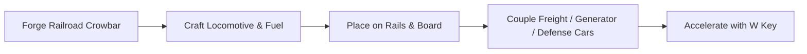

# 🚂 Mining Tools (Track & Train Kit) — Official Wiki & Walkthrough

Welcome to the comprehensive player manual, engineering walkthrough, and crafting compendium for **Track and Train Pack (Mining Tools)** on Minecraft 26.3 (NeoForge).

---

## 📑 Table of Contents

1. [Quick-Start Guide: Your First Train](#1-quick-start-guide-your-first-train)
2. [Locomotives & Motive Power](#2-locomotives--motive-power)
   - [Basic Steam Locomotive](#basic-steam-locomotive)
   - [CN Diesel Locomotive (#3087)](#cn-diesel-locomotive-3087)
   - [Calibrated Speed Profiles & Cruise Control](#calibrated-speed-profiles--cruise-control)
   - [Diesel Fuel Tender Siphoning](#diesel-fuel-tender-siphoning)
   - [Electric Bullet Train](#electric-bullet-train)
   - [Locomotive Controls & HUD Dashboard](#locomotive-controls--hud-dashboard)
3. [Train Chaining, Physics & Railroad Crowbar](#3-train-chaining-physics--railroad-crowbar)
   - [Coupling & Uncoupling Mechanics](#coupling--uncoupling-mechanics)
   - [Universal Consist Kinematics & Yard Shunting Rules](#universal-consist-kinematics--yard-shunting-rules)
   - [Solid Bumper Collisions & Rapid Halting Damping](#solid-bumper-collisions--rapid-halting-damping)
   - [Authentic Slope Kinematics & Rail Pinning](#authentic-slope-kinematics--rail-pinning)
   - [Universal Caboose Placement](#universal-caboose-placement)
   - [Traction, Drag & Multiple-Unit (MU) Consists](#traction-drag--multiple-unit-mu-consists)
4. [Rolling Stock Catalog](#4-rolling-stock-catalog)
   - [Adaptive Cargo Minecart](#adaptive-cargo-minecart)
   - [Loose Aggregate Hopper Car (Hopper Minecart)](#loose-aggregate-hopper-car-hopper-minecart)
   - [Generator Train Cart (Mobile Steam Dynamo)](#generator-train-cart-mobile-steam-dynamo)
   - [Livestock Cart (Railroad Stock Car)](#livestock-cart-railroad-stock-car)
   - [Liquid Minecarts (Small & Large)](#liquid-minecarts-small--large)
   - [Arrow Turret Cart](#arrow-turret-cart)
   - [Anchor Caboose](#anchor-caboose)
5. [Specialty Switch & Power Rails](#5-specialty-switch--power-rails)
   - [Braking / Holding Rail](#braking--holding-rail)
   - [Junction Rail (4-Way Cross)](#junction-rail-4-way-cross)
   - [Turnout Rail (T-Switch)](#turnout-rail-t-switch)
   - [Wye Rail (Triangular 3-Way Switch)](#wye-rail-triangular-3-way-switch)
   - [Locomotive Control Rail & Horn Rail](#locomotive-control-rail--horn-rail)
   - [Electric Rail (Third-Rail Power)](#electric-rail-third-rail-power)
6. [Trackside Automation Facilities](#6-trackside-automation-facilities)
   - [Trackside Cargo Loader & Cargo Unloader](#trackside-cargo-loader--cargo-unloader)
   - [Dedicated Locomotive Fuelers (Fuel Isolation)](#dedicated-locomotive-fuelers-fuel-isolation)
   - [Trackside Fluid Loader & Fluid Unloader](#trackside-fluid-loader--fluid-unloader)
   - [In-GUI Custom Cart & Train Naming](#in-gui-custom-cart--train-naming)
   - [Trackside Entity Loader & Unloader](#trackside-entity-loader--unloader)
   - [Mechanical Track Signal Switch Stand](#mechanical-track-signal-switch-stand)
   - [Railway Buffer Stop (Stop Block)](#railway-buffer-stop-stop-block)
   - [Industrial Chunk Anchor](#industrial-chunk-anchor)
7. [Heavy Machinery: The Tunnel Bore & Track Paver](#7-heavy-machinery-the-tunnel-bore--track-paver)
   - [Automated Tunnel Bore](#automated-tunnel-bore)
   - [Heavy Track & Road Paver (AP1055F)](#heavy-track--road-paver-ap1055f)
8. [Geological Prospecting & Survey System](#8-geological-prospecting--survey-system)
   - [Surveyor's Charge](#surveyors-charge)
   - [Remote Detonator](#remote-detonator)
   - [Configuration Options](#configuration-options)
9. [Complete Crafting Recipe Compendium](#9-complete-crafting-recipe-compendium)
   - [Locomotives & Motive Power](#locomotives--motive-power-1)
   - [Rolling Stock & Defense Carts](#rolling-stock--defense-carts)
   - [Specialty Rails & Tools](#specialty-rails--tools)
   - [Trackside Facilities & Heavy Machinery](#trackside-facilities--heavy-machinery)
   - [Geological Prospecting & Surveying Tools](#geological-prospecting--surveying-tools)
10. [Version History & Changelog](#10-version-history--changelog)

---

## 1. Quick-Start Guide: Your First Train



1. **Craft a Railroad Crowbar**: The essential tool for all railway engineers (`1 Iron Ingot + 1 Iron Nugget`).
2. **Build a Locomotive**: Start with the **Basic Steam Locomotive** (`Furnace + Minecart + Iron Ingots + Redstone`) or the **CN Diesel Locomotive**.
3. **Lay Tracks**: Standard rails, powered rails, **Braking Rails**, or custom **Control Rails**.
4. **Assemble the Consist**: Place your locomotive in front, followed by your rolling stock (Cargo Carts, Hopper Cars, Generator Carts, Tankers, or an Anchor Caboose).
5. **Couple the Cars**: Hold the **Railroad Crowbar** in hand, right-click the Locomotive, then right-click the cart directly behind it. Repeat down the length of the train. Cars can also be coupled together freely without a locomotive!
6. **Fuel Up & Board**: Right-click the locomotive to board, press `C` to open the fuel inventory, deposit Coal or Diesel fuel, and tap `W` to throttle up!

---

## 2. Locomotives & Motive Power

Every locomotive in Mining Tools features realistic acceleration physics, multi-gear throttle transmissions, dynamic directional lighting (casting real light ahead of the engine), audible warning horns, and a live cockpit HUD.

```
       ______
      /|_||_\`.__
     (   _    _ _\
     =`-(_)--(_)-'  Mining Tools Locomotive Fleet
```

---

### Basic Steam Locomotive
The reliable workhorse of standard industrial railroads.

* **Fuel Source**: Coal, Charcoal, or any solid furnace fuel (default: 80 seconds of burn time per piece of coal).
* **Speed Profile**: 5 forward gears. **Gear 1 is calibrated to a precise Crawl Speed of 1.0 m/s (0.05 blocks/tick)** for precision switching and coupling maneuvers, scaling up to Gear 5 at `0.35` blocks/tick (`~7 m/s` or `25 km/h`).
* **Cruise Control**: Gear 3 runs at **50% of maximum speed** (`~0.175` blocks/tick).
* **Pulling Allowance**: Pulls up to **5 carts** with zero friction penalty. Pulling 6+ carts causes progressive drag slowdown.
* **Cowcatcher**: Deflects and pushes wandering animals and minor obstacles out of the rail path.
* **Steam Whistle**: Emits a loud piercing whistle that causes nearby mobs to flee the tracks.

---

### CN Diesel Locomotive (#3087)
A heavy-haul mainline road-switcher modeled after classic Canadian National diesel engines.

* **Top Speed**: **2× the speed of steam** (`0.70` blocks/tick, `~14 m/s` or `50 km/h`).
* **Fuel Source**: Liquid Diesel Fuel. Holds an internal **16,000 mB (16-bucket)** tank.
  - Native support for `#c:diesel`, `#c:biofuel`, and `#c:biodiesel` (compatible with Industrial Refinery, Ultimate Car Mod, etc.).
  - Equipped with a quick bucket-draining slot directly in its cockpit menu.
* **Pulling Allowance**: Heavy-duty prime mover pulls up to **10 carts** with zero drag penalty.
* **Multiple-Unit (MU) Synergy**: Designed to be coupled with additional diesel engines to haul 20–30+ freight car trains across continental distances.

---

### Calibrated Speed Profiles & Cruise Control

The CN Diesel Locomotive features 5 precisely calibrated throttle positions:

| Gear | Designator | Velocity (Blocks/Tick) | Real-World Speed | Operational Role |
| :---: | :--- | :---: | :---: | :--- |
| **1** | Crawl | `0.050 b/t` | `1.00 m/s` (3.6 km/h) | Precision coupling & turntable positioning |
| **2** | Slow Yard | `0.1125 b/t` | **2.25 m/s** (8.1 km/h) | Depot shunting, siding maneuvers & industrial sidings |
| **3** | Cruise | `0.350 b/t` | **7.00 m/s** (25.2 km/h) | **50% Top Speed**: Fuel-efficient mainline cruising |
| **4** | Express | `0.560 b/t` | `11.20 m/s` (40.3 km/h) | Priority through-freight & express delivery |
| **5** | High-Ball | `0.700 b/t` | `14.00 m/s` (50.4 km/h) | 100% Maximum throttle for open mainline rails |

---

### Diesel Fuel Tender Siphoning
The **CN Diesel Locomotive** features automated fuel tender wagon siphoning:
* **Coupled Tender Detection**: Hitching a **Liquid Minecart** (8,000 mB) or **Large Liquid Minecart** (16,000 mB) directly behind or ahead of the locomotive turns the tanker into a functional fuel tender wagon.
* **Continuous Siphoning**: The locomotive automatically scans its coupled consist and draws compatible diesel, biofuel, or oil from the tanker at up to **100 mB per game tick** whenever internal fuel reserves drop below full capacity.
* **Long-Distance Hauling**: Enables fully automated, long-haul continental rail routes without manual refueling stops.

---

### Electric Bullet Train
Ultra-high-speed, zero-emission passenger and express transit.

* **Top Speed**: **5× the speed of steam** (`1.75` blocks/tick, `~35 m/s` or `126 km/h`).
* **Cruise Control**: Gear 3 cruises at **50% of maximum speed** (`0.875` blocks/tick or `63 km/h`).
* **Power Source**: Forge Energy (FE). Equipped with an onboard **100,000 FE** internal battery.
* **Third-Rail Continuous Power**: When traveling along track segments equipped with **Electric Rails**, the pantograph/shoe draws electricity directly from the grid on the fly without stopping!
* **Mobile Dynamo Recharging**: Coupling a **Generator Train Cart** anywhere in the consist provides direct, continuous recharging on unelectrified routes.
* **Pulling Allowance**: Pulls up to **10 carts** at maximum velocity.

---

### Locomotive Controls & HUD Dashboard

When seated in a locomotive or any coupled rolling-stock car:

| Action | Keybinding | In-Game Effect |
| :--- | :---: | :--- |
| **Throttle Up / Start** | <kbd>W</kbd> | Engages the engine and throttles up |
| **Brake / Stop** | <kbd>S</kbd> | Cuts throttle and smoothly applies train brakes |
| **Gear Down** | <kbd>A</kbd> | Lowers cruise gear (Gears 1 through 5) |
| **Gear Up** | <kbd>D</kbd> | Raises cruise gear (Gears 1 through 5) |
| **Reverse** | <kbd>R</kbd> | Toggles forward/reverse gear without flipping the model |
| **Horn / Whistle** | <kbd>H</kbd> | Sounds horn/whistle; scares mobs away from track |
| **Headlights** | <kbd>L</kbd> | Toggles high-beam headlights (dynamic block light level 15) |
| **Cockpit GUI** | <kbd>C</kbd> | Opens fuel reserves, battery gauges, and naming menu |

#### HUD Dashboard Indicators
While driving, the lower-left overlay displays:
- **Speed**: Live digital speedometer in `blocks/sec` and `km/h`.
- **Gear**: Current throttle position (`P` = Park/Brake, `1` through `5` = Cruise Gears, `R` = Reverse).
- **Heading**: Cardinal compass direction (`NORTH`, `SOUTH`, `EAST`, `WEST`).
- **Reserves**: Remaining burn ticks (Steam), fuel level in mB (Diesel), or battery charge in FE (Electric).

---

## 3. Train Chaining, Physics & Railroad Crowbar

```
 [Locomotive] <===Chain===> [Cargo Cart] <===Chain===> [Caboose]
```

The **Railroad Crowbar** transforms isolated vanilla minecarts into coordinated, multi-car train consists.

### Coupling & Uncoupling Mechanics
1. **Coupling**:
   - Hold the **Railroad Crowbar** in your main hand.
   - Right-click the first cart (a metal clicking sound confirms selection).
   - Right-click an adjacent cart within coupling distance (approx. 2–3 blocks).
   - A heavy steel chain appears connecting the two cars.
2. **Uncoupling**:
   - Sneak + Right-click (`Shift + Right-Click`) any coupled car with the Crowbar to break the link.
3. **Train Direction & Reversing**:
   - Trains maintain synchronized physics. Pulling in reverse pulls the rear cars backward smoothly without jarring 180° visual rotations.

---

### Universal Consist Kinematics & Yard Shunting Rules
- **Locomotive-Free Consist Coupling**: Rolling stock carts can be coupled together using the Railroad Crowbar even before a locomotive is attached.
- **Synchronized Unpowered Motion**: Pushing or gravity-rolling any individual car in an unpowered consist moves the entire linked train along the rails at exact coupler spacing, allowing players to shunt strings of cars by hand in rail yards.
- **Yard Shunting Safety Rules**: To prevent accidental bumping while walking through yards, unpowered carts only roll from player contact when the player is **sprinting** or **sneaking** (holding Shift without a Crowbar). Normal walking leaves stationary carts securely in place.
- **Braking Rail Hold**: If any cart in a consist is parked over an unpowered Braking Rail, the entire consist remains firmly clamped against hand pushing.

---

### Solid Bumper Collisions & Rapid Halting Damping
- **Anti-Phasing Collision Engine**: Vanilla Minecraft minecart collision logic suffers from a bug where carts with opposing or unaligned yaw vectors cancel push physics (`vec3.dot(vec31) < 0.8`), causing loose carts to phase straight through each other. Mining Tools overrides this with custom physical bumper separation (`TrainChainingUtil.pushMinecarts`).
- **Post-Bump Rapid Braking**: When loose carts collide on tracks, momentum is exchanged and active collision damping (`ROLLING_STOCK_BUMP_DAMPING`) rapidly bleeds off residual kinetic energy. Both carts quickly come to a complete, stable stop rather than bouncing endlessly or rolling away unattended.
- **Coupled Car Bypassing**: Cars that are already coupled in the same consist bypass internal push collisions, ensuring long trains navigate tight switch curves without binding or jittering.

---

### Authentic Slope Kinematics & Rail Pinning
- **True Rail Elevation Math**: Re-engineered using exact vanilla Minecraft rail incline geometry (`exit.getY() * 0.5`, `yD * 2.0`, vertical slope offset `+0.5` / `+1.0`). Carts remain perfectly pinned to the rail crown without sinking into rail ties or blocks beneath the track.
- **Pre-Lift Climbing**: The physics engine applies a pre-lift step prior to executing `cart.move()`, guaranteeing smooth ascension over ascending switch tracks and steep mountain grades.
- **Clean Collision Phasing**: Completely eliminates artificial `noPhysics` clipping hacks, preventing carts from phasing into mountain terrain or subterranean rock.
- **45° Model Incline Pitching**: Carts smoothly tilt at 45° matching the track slope without visual spinning, jittering, or separation of couplers.
- **Anti-Rollback Hill Stays**: Active trains climbing slopes maintain firm traction without bunching up or rolling backward into the valley.

---

### Universal Caboose Placement
- **Flexible Consist Positioning**: The **Anchor Caboose** is no longer restricted to the rear of the train! It can now be coupled at the front, middle, or rear of any train consist.
- **Continuous Mobile Chunk Loading**: Regardless of its position in the consist, the Caboose maintains a continuous 3×3 active chunk perimeter around itself and keeps all chunks occupied by the entire linked train loaded simultaneously.

---

### Traction, Drag & Multiple-Unit (MU) Consists

Each locomotive adds its **Pulling Allowance** to the entire train:
- **1 Steam Locomotive**: 5 cars maximum without penalty.
- **2 Steam Locomotives**: 5 + 5 = 10 cars maximum without penalty.
- **1 Diesel Locomotive + 1 Steam Locomotive**: 10 + 5 = 15 cars maximum without penalty.
- **2 Diesel Locomotives**: 10 + 10 = 20 cars maximum without penalty.

> [!TIP]
> Locomotives do **not** all need to be at the front! You can place one engine at the front (lead), one in the middle (mid-train helper), or one at the rear (pusher/banking engine). All connected locomotives automatically share throttle commands and combine their pulling power.

---

## 4. Rolling Stock Catalog

### Adaptive Cargo Minecart
A heavy-duty freight wagon with **27 storage slots** plus a dedicated **Filter Slot**. The cart's 3D exterior model dynamically changes based on what you filter:

| Filter Mode | Items Accepted | 3D Visual Appearance |
| :--- | :--- | :--- |
| **Log Mode** | Any wooden logs (`#minecraft:logs`) | Heavy upright log stakes loaded with rustic timber logs |
| **Container Mode** | General items, tools, ingots, food | Enclosed, corrugated industrial shipping container |
| **Ore Mode** | Raw iron, copper, gold, coal, lapis, redstone | Open hopper filled with towering mounds of raw mineral ores |
| **Ingot Mode** | Refined metal ingots | Neatly stacked precious metal bars |

> [!NOTE]
> To lock a filter, place the target item into the top-right filter slot inside the Cargo Cart GUI. The cart will now reject any non-matching items from hoppers and loaders.

---

### Loose Aggregate Hopper Car (Hopper Minecart)
A heavy-duty open-top hopper car designed for hauling bulk loose aggregates such as ballast gravel, sand, dirt, raw ores, and coal (modeled after North American TIMX and Herzog ballast hoppers).

#### 3D Visual Aggregate Heaps
- **Empty State**: Renders as an authentic hollow open hopper container showing interior sloped bottom discharge chutes.
- **Loaded State**: Dynamically renders 3 mounded aggregate heaps piled inside the container whenever loose materials are loaded.
- **Dynamic Textures**: Automatically selects and renders the exact texture matching the stored aggregate:
  - **Coal**: Rich black coal mounds.
  - **Gravel / Ballast**: Crushed ballast stone heaps (gravel, cobblestone, andesite, diorite, granite, tuff).
  - **Sand**: Clean yellow sand mounds.
  - **Red Sand**: Terracotta red sand heaps.
  - **Dirt**: Soil / clay mounds.
  - **Raw Ore**: Metal raw ore aggregates (`#c:raw_materials`, `#c:ores`).

#### Inventory & Filter Slot
- **27 Storage Slots**: High-capacity bulk cargo storage.
- **Dedicated Filter Slot**: Located with a custom hopper funnel icon. Placing a sample material into this slot locks the car to only accept that aggregate type from hoppers and trackside loaders.
- **Track-Aligned Placement**: Automatically aligns initial yaw to the track upon placement, preventing rotation anomalies on curves or switches.

---

### Generator Train Cart (Mobile Steam Dynamo)
An industrial steam dynamo and Forge Energy (FE/RF) generator cart styled with a detailed 3D dynamo model (under 1.5 blocks tall).

```
      [ Dynamo Generator ]
   ( Water Tank ) ( Steam Core )
  =================================  [ Generator Cart ]
       (O)                 (O)
```

#### Technical Specifications
- **Energy Output**: Generates **100 FE/t** (configurable) when fueled with solid fuel and water.
- **Energy Buffer**: Internal **100,000 FE** rechargeable battery.
- **Water Capacity**: Internal **8,000 mB (8 Buckets)** water reservoir.
- **Fuel Consumption**: 1 mB of water every 2 ticks (10 mB/sec) while active. Consumes standard solid fuels (Coal, Charcoal, Coal Blocks, Blaze Rods, Wood).

#### Dynamic Throttling & Fuel Conservation
- The generator automatically shuts off fuel combustion when its internal battery is saturated or when water is depleted, ensuring zero fuel waste during train halts.

#### Consist & Trackside Energy Distribution
1. **Electric Train Support**: Automatically transmits power to coupled **Electric Bullet Trains** anywhere in the consist, enabling electric rail travel without third rails!
2. **Adjacent Block Transfer**: Directly powers adjacent energy conduits, storage blocks, and machines located beside or underneath the track.
3. **Wireless Proximity Broadcast**: Wirelessly radiates power to all energy receivers and cables within a **3-block radius** (configurable up to 16 blocks).
4. **Item Charging**: Features a dedicated energy item slot (Slot 3) in its GUI to recharge held batteries, tools, and capacitors.
5. **Water Tender Siphoning**: Automatically siphons water from coupled Liquid Minecart tenders to stay topped off on long journeys.

---

### Livestock Cart (Railroad Stock Car)
An authentic North American railroad stock car modeled to scale with rolling stock:

* **Dual Stall Capacity**: Accommodates up to **2 entities** simultaneously across distinct front and rear stalls.
* **Open Slatted Wooden Construction**: Built with horizontal wooden slats, keeping livestock well-ventilated and clearly visible as the train travels.
* **Leash Hitching**: Right-clicking the cart while leading an animal on a Lead instantly unleashes and boards the animal inside.
* **Smart Facility Compatibility**: Integrates directly with the **Trackside Entity Loader** and **Trackside Entity Unloader**.
* **Activator Rail Ejection**: Rolling over a powered Activator Rail gently dismounts passengers at destination pens.

---

### Liquid Minecarts (Small & Large)
Specialized tanker wagons designed to safely transport fluids across rail lines:

* **Small Liquid Minecart**: 8,000 mB (8 Buckets) capacity.
* **Large Liquid Minecart**: 16,000 mB (16 Buckets) heavy rail tanker.
* **Fuel Tender Capability**: Automatically acts as a fuel tender when coupled to the CN Diesel Locomotive, siphoning up to 100 mB/tick.
* **Water Tender Capability**: Automatically acts as a water tender when coupled to the Generator Train Cart.
* **Smart Transfer**: Integrates with the **Trackside Fluid Loader** and **Trackside Fluid Unloader**.

---

### Arrow Turret Cart
An armored rolling-stock defense wagon styled after the Caboose and heavy freight cars to protect trains from hostiles.

* **Dual Weapon Slots**: Mount up to **2 Bows** into dedicated gun ports on the rotating turret.
* **9-Slot Ammo Magazine**: Carries up to 9 stacks of arrows (standard, tipped, or spectral arrows).
* **Automated Hostile Defense**: Scans within a **16-block radius** for hostile mobs (`Enemy`) and fires alternate staggered volleys from its dual bow mounts.
* **Target Filtering**: Automatically ignores players, animals, villagers, and passenger mobs on trains.
* **Dynamic Turret Rotation**: The armored cupola smoothly tracks and swivels towards active targets.

---

### Anchor Caboose
The ultimate train-preservation device hitched to your consist.

* **Mobile Chunk Loading**: Keeps a **3×3 chunk zone** centered on itself permanently active in memory as it travels.
* **Consist Anchor**: Keeps every chunk occupied by the entire linked train loaded simultaneously, eliminating runaway cars, desyncs, and trains separating at chunk boundaries.
* **Atmospheric Visuals**: Detailed rear observation porch with handrails and a smoking coal-stove chimney pipe.
* **Universal Coupling**: Can be placed at the front, middle, or rear of the train consist.

---

## 5. Specialty Switch & Power Rails

```
     |                     \   /                   |   /
   --+-- (Junction)          X   (Wye Rail)        |  /  (Turnout)
     |                     / | \                   | /
```

### Braking / Holding Rail
A specialized clamping rail for depots, passenger stations, and automated freight docks:
* **Unpowered State (POWERED = false)**: Instantly halts and securely clamps any passing or resting minecart, locomotive, or train consist. Freezes velocity to zero and cuts engine drive.
* **Powered State (POWERED = true)**: Releases holding brakes and resumes train consist cruise travel, or gives loose carts a gentle launching impulse along the rails.
* **Automation Synergy**: Works in tandem with **Cargo Loaders**, **Cargo Unloaders**, and **Fluid Loaders**, which depower the Braking Rail during transfer and re-power it once loading criteria are met.

---

### Junction Rail (4-Way Cross)
A flat, perpendicular cross rail (`+`).
* Unlike vanilla rails which force curves when intersecting, the Junction Rail allows trains coming from North-South and East-West to cross right through each other without turning, slowing down, or derailing.

---

### Turnout Rail (T-Switch)
A mainline straight rail with a divergent turnout branch.
* **Control**: Toggleable by **Redstone signal** or by right-clicking with a **Railroad Crowbar** or bare hand.
* **Animated Switch Blades**: Features movable rail points that visibly slide open and closed to indicate which route is currently set.
* **Non-Derailing Run-Through**: Trains approaching from the trailing frog can safely merge onto the mainline without bouncing.

---

### Wye Rail (Triangular 3-Way Switch)
A triangular junction rail designed for wye tracks, balloon loops, and mainline branches.
* **Directional Logic**:
  - Approaching from the **Stem**: Sent East or West depending on the Redstone state.
  - Approaching from the **Branches**: If the switch matches your incoming direction, you merge smoothly into the stem. If the switch is aligned for the opposite branch, you pass straight through along the mainline.
* **Visual Direction Indicators**: Highlights active guide rails in red/yellow so engineers can see switch alignment from a distance.

---

### Locomotive Control Rail & Horn Rail
Specialty functional tracks embedded directly into the railbed:

* **Locomotive Control Rail**:
  - **Unpowered**: Gently halts approaching trains and holds them stationary (ideal for automated passenger stations and freight loading docks).
  - **Powered**: Launches stopped trains forward at the locomotive's preset cruise gear. Reversing the redstone feed reverses train direction.
* **Locomotive Horn Rail**:
  - Pressure-plate rail track that automatically sounds the whistle/horn of any passing locomotive.
  - Essential for level road crossings, tunnel entrances, and warning track workers.

---

### Electric Rail (Third-Rail Power)
* A high-voltage third-rail track with copper contact conductors.
* Connects directly to Forge Energy (FE) power networks.
* Charges **Electric Bullet Trains** at speeds up to **2,000 FE/tick** as they pass overhead, enabling endless electric train networks without battery swapping!

---

## 6. Trackside Automation Facilities

### Trackside Cargo Loader & Cargo Unloader
Placed directly underneath tracks to automate solid freight transfer:

```
     [ Braking Rail ]
  ----------------------
   [ Cargo Loader/Unloader ]
```

* **Cargo Loader (`cargo_loader`)**: Loads solid items from its internal 9-slot buffer into passing Cargo Minecarts and Hopper Cars.
* **Cargo Unloader (`cargo_unloader`)**: Extracts solid items from passing freight carts into its internal buffer for piping or hopper extraction.
* **Item Whitelist / Blacklist**: Dedicated filter slot allows filtering for specific items (or forbidding specific items).
* **Train Name Filtering**: Only services carts matching a designated train name string.
* **Transfer Thresholds**: Configurable to hold until **100% Full / Empty** or allow partial loads.
* **Automatic Braking Rail Control**: Automatically depowers an overhead or adjacent Braking Rail while transfer is underway, clamping the train until loading criteria are satisfied!

---

### Dedicated Locomotive Fuelers (Fuel Isolation)
Specialized fueling stations designed to prevent locomotive operational fuel from mixing with general freight cargo:

* **Diesel Locomotive Fueler (`diesel_fueler`)**:
  - Exclusively fills the internal diesel tank of **CN Diesel Locomotives**.
  - Will **never** pump fuel into general freight liquid tanker carts.
* **Steam Locomotive Coal Fueler (`coal_fueler`)**:
  - Exclusively feeds coal, charcoal, or furnace fuel into the firebox of **Basic Steam Locomotives**.
  - Will **never** deposit coal into general cargo or hopper carts.
* **Fuel Protection**: General Cargo Loaders/Unloaders and Fluid Loaders/Unloaders strictly ignore locomotive engine tanks, preventing freight yards from stealing locomotive operational fuel.

---

### Trackside Fluid Loader & Fluid Unloader
Placed underneath tracks to automate fluid logistics:
* **Fluid Loader (`fluid_loader`)**: Pumps fluids from its 16,000 mB buffer reservoir into Liquid Minecarts.
* **Fluid Unloader (`fluid_unloader`)**: Drains fluids from Liquid Minecarts into connected piping.
* **Braking Integration**: Depowers adjacent Braking Rails to clamp tankers during fluid transfer and releases them upon completion.

---

### In-GUI Custom Cart & Train Naming
All locomotives and rolling stock carts feature editable name fields inside their interactive GUIs:
* Name your rolling stock (e.g. `"Ore-Express-1"`, `"Fuel-Tender-A"`, `"Shuttle-South"`).
* **Track Switch Integration**: The Mechanical Track Signal Switch automatically inspects cart names and switches routes based on your rules.
* **Station Filter Integration**: Cargo and fluid stations can be set to only load or unload carts bearing specific custom names.

---

### Trackside Entity Loader & Unloader
Placed directly underneath tracks to automate livestock, villager, and mob transit:
* **Entity Loader**: Automatically boards nearby entities into passing empty minecarts or Livestock Carts. Whitelist/Blacklist specific mob IDs, baby/adult filters, and 1–16 block radius.
* **Entity Unloader**: Safely dismounts passengers from passing carts and teleports them to adjacent solid ground away from tracks.

---

### Mechanical Track Signal Switch Stand
An authentic trackside switch stand with an animated directional lantern and mechanical target arm.
* **Named Train Dispatching**: Set custom routing rules in its GUI (e.g. route `"Ore Express"` onto sidings while `"Mainline"` continues straight).
* **Signal Integration**: Automatically changes Turnout and Wye rails in response to approaching named trains.

---

### Railway Buffer Stop (Stop Block)
A heavy-duty end-of-track railway barrier modeled after industrial railroad buffer stops:
* **Physical Rail Clamping**: Dual A-frame structural steel legs clamp onto incoming tracks at standard rail gauge.
* **Engine Auto-Cutoff**: Safely cuts throttle and stops running engines immediately on impact with authentic clatter sounds and sparks.
* **Terminal Redstone Detection**: Emits a continuous redstone signal (strength 15) while a train rests against it, ideal for depot signaling and terminal light automation.
* **Crowbar Reorient**: Right-click with the Crowbar to rotate its facing direction.

---

### Industrial Chunk Anchor
A stationary, heavy-duty chunk loader block for factories, automated quarries, tree farms, and station hubs:
* **Configurable Radius**: Cycle between **1×1 Chunk (Single)**, **3×3 Chunks (9 Chunks)**, or **5×5 Chunks (25 Chunks)**.
* **Redstone Modes**: Toggle between **Always Active** and **Redstone Required**.
* **Visual Status**: Glowing cyan energy core, green status LED, and subtle portal particles.

---

## 7. Heavy Machinery: The Tunnel Bore & Track Paver

### Automated Tunnel Bore

The **Tunnel Bore** is a massive automated subterranean excavation machine that carves 3×3 subway tunnels through solid mountain rock.

```
       [ Top-Down Excavator Head ]
       |  [Stone]  [Stone]  [Stone]  |
       |  [Stone]  [AIR]    [Stone]  |  ---> 3x3 Tunnel Path
       |  [Solid]  [Rail]   [Solid]  |
```

#### Key Engineering Features:

1. **3×3 Frontal Excavation**: Pulverizes stone, deepslate, granite, ores, and dirt in a 3-block-wide by 3-block-tall cross-section. Drops deposit into the bore's internal storage inventory.
2. **Top-Down Drilling Sequence**: Breaks overhead blocks first before drilling lower blocks so loose sand and gravel pockets fall safely into the drill head.
3. **Automated Track Laying**: Automatically places rails from its **9-slot dedicated Track Inventory** onto solid ground directly beneath its rear bogies as it advances.
4. **Ballast Inventory & Auto Gap-Bridging**: Features a dedicated **9-slot Ballast Inventory** accepting gravel, sand, cobblestone, and stone. Automatically fills chasms, ravines, and lava voids to bed a solid foundation.
5. **Safety Sensors**: Automatically halts upon reaching bedrock, chasms exceeding ballast reserves, or running out of track/fuel.
6. **Bi-Directional Operation**: Forward drilling mode and safe reversing mode.

---

### Heavy Track & Road Paver (AP1055F)

A heavy-duty industrial caterpillar track paver machine inspired by the CAT AP1055F continuous track paver (~2.75 blocks wide, 2.0 blocks high, 3.0 blocks long).

```
         [ Operator Station ] (Smokestack)
      [Engine Hood]       |         |
   \======================+=========+=====/   <-- Front Hopper & Chassis
     (O) (O) (O) (O) (O) (O) (O) (O) (O)      <-- Continuous Crawler Treads
  =========================================== [ Rear 3-Wide Screed ]
```

#### Key Operational Capabilities:

1. **Calibrated 1.0 m/s Paving Speed**:
   - Advanced movement system moves forward at an exact **1.0 m/s** (20 ticks per 1-block step).
   - Replaces blocks across a **1-block deep by 3-block wide transverse strip** (Left, Center, Right) across the rear hydraulic leveling screed.
2. **Trackbed Preservation Under Railway Tracks**:
   - When paving across or underneath existing railway tracks, the paver detects rails directly above the target block.
   - Replaces the underlying ballast/foundation block **without popping, breaking, or disturbing the track** on top!
   - Ideal for upgrading dirt/gravel roadbeds underneath active rail lines to concrete, stone bricks, or custom ballast without manual rail re-laying.
3. **On-Rails & Off-Rails Traversal**:
   - Operates freely over rough terrain, grass, dirt, and roads without requiring tracks.
   - Features **1.0-block climbing step-up**, allowing the heavy crawler treads to climb ledges and ascending hills smoothly.
   - If placed on top of a rail or driven onto tracks, the paver automatically snaps to rail center and aligns its heading to the railway path.
4. **Cardinal Direction Locking (N / S / E / W)**:
   - Dedicated GUI button allows locking travel strictly to **North, South, East, or West**.
   - Guarantees dead-straight highway corridors and railway track foundations without drifting or angular divergence.
   - Unlocking allows free steering using standard turn controls.
5. **Manual Driving & Automated Cruise Paving**:
   - **Manual Operator Mode**: Right-click to mount the elevated right-hand operator seat. Drive with <kbd>W</kbd> (forward 1 m/s), <kbd>S</kbd> (brake/stop), <kbd>A</kbd>/<kbd>D</kbd> (steer), <kbd>R</kbd> (reverse), <kbd>Space</kbd> (toggle cruise), and <kbd>C</kbd> (cockpit GUI).
   - **Automated Mode**: Start via GUI "Start" button or dismount while cruise is active; the paver continues rolling forward and laying pavement automatically until halted or out of material/fuel.
6. **27-Slot Material Hopper & Filter Slot**:
   - **Slot 0 (Paver Block Filter)**: Place any full solid block here to lock the paving material (e.g. Stone Bricks, Ballast, Concrete, Polished Andesite, Asphalt). If empty, the paver uses the first valid block found in its hopper.
   - **Slot 1 (Fuel Slot)**: Powered by Coal, Charcoal, Coal Blocks, Blaze Rods, or wood. (1 coal = 80 blocks paved).
   - **Slots 2–28 (27 Material Slots)**: A full 3×9 chest-sized bulk inventory holding up to 1,728 blocks of paving material. Consumes 1 block item per block placed (free in Creative mode). Replaced blocks are automatically harvested and collected into available hopper slots.

---

## 8. Geological Prospecting & Survey System

### Surveyor's Charge
A specialized seismic explosive designed for subterranean resource prospecting and rapid vertical borehole excavation.
- **Crafting Recipe (Shapeless)**: `1 Redstone Dust + 1 TNT + 1 Arrow`
- **Blast Mechanics**: Blasts a clean 1×1 vertical borehole directly downward from its placement coordinate down to bedrock.
- **Full-Depth Cylindrical Column Survey**: Scans a cylindrical column (default 10-block radius) from charge level down to bedrock (`level.getMinY()`).
- **Oil & Fluid Detection**: Aggregates and reports oil fluids and source blocks (`#c:oil`, `#c:crude_oil`, petroleum, diesel, fuel).
- **Survey Telemetry**: Transmits a detailed ore and resource breakdown directly into your chat.

### Remote Detonator
A handheld wireless detonator keyed to trigger Surveyor's Charges.
- **Crafting Recipe (Shapeless)**: `1 Redstone Dust + 1 Lever + 1 Iron Ingot`
- **Operation**: Right-click to detonate all Surveyor's Charges within a 12-block radius and receive telemetry instantly.

### Configuration Options
Located in `config/miningtools-common.toml`:
- `surveyor_charge.radius` (Default: 10): Column scan horizontal radius.
- `surveyor_charge.dropBoreholeBlocks` (Default: false): Toggle borehole block item drops.
- `surveyor_charge.remoteDetonatorRange` (Default: 12.0): Remote detonator trigger radius.
- `surveyor_charge.ignoredBlocks`: Block IDs omitted from survey reports.

---

## 9. Complete Crafting Recipe Compendium

All recipes are crafted in a standard 3×3 Crafting Table:

### Locomotives & Motive Power

#### Basic Steam Locomotive
```
[ . ] [ R ] [ . ]    R = Redstone Dust
[ I ] [ F ] [ I ]    I = Iron Ingot, F = Furnace
[ I ] [ M ] [ I ]    M = Minecart
```

#### CN Diesel Locomotive (#3087)
```
[ . ] [ G ] [ . ]    G = Glass
[ I ] [ R ] [ B ]    I = Iron Block, R = Redstone Block, B = Bucket
[ . ] [ M ] [ . ]    M = Minecart
```

#### Electric Bullet Train
```
[ . ] [ G ] [ . ]    G = Tinted Glass
[ I ] [ R ] [ C ]    I = Iron Block, R = Redstone Block, C = Copper Block
[ . ] [ M ] [ . ]    M = Minecart
```

---

### Rolling Stock & Defense Carts

#### Adaptive Cargo Minecart *(Shapeless)*
```
[ Minecart ] + [ Chest ] + [ Iron Ingot ]
```

#### Loose Aggregate Hopper Car
```
[ I ] [ . ] [ I ]    I = Iron Ingot
[ I ] [ H ] [ I ]    H = Hopper
[ . ] [ C ] [ . ]    C = Chest Minecart
```

#### Generator Train Cart (Mobile Steam Dynamo)
```
[ C ] [ R ] [ C ]    C = Copper Ingot, R = Redstone Dust
[ I ] [ F ] [ I ]    I = Iron Ingot, F = Blast Furnace
[ I ] [ M ] [ I ]    M = Minecart
```

#### Livestock Cart (Railroad Stock Car)
```
[ P ] [ P ] [ P ]    P = Wooden Planks (Any)
[ F ] [ L ] [ F ]    F = Wooden Fence (Any), L = Lead
[ P ] [ M ] [ P ]    M = Minecart
```

#### Liquid Minecart (8-Bucket Tanker)
```
[ . ] [ C ] [ . ]    C = Copper Ingot
[ I ] [ B ] [ I ]    I = Iron Ingot, B = Bucket
[ . ] [ M ] [ . ]    M = Minecart
```

#### Large Liquid Minecart (16-Bucket Tanker)
```
[ . ] [ I ] [ . ]    I = Iron Ingot
[ L ] [ B ] [ L ]    L = Liquid Minecart, B = Bucket
[ . ] [ I ] [ . ]
```

#### Arrow Turret Cart
```
[ B ] [ I ] [ B ]    B = Bow
[ I ] [ D ] [ I ]    I = Iron Ingot, D = Dispenser
[ I ] [ M ] [ I ]    M = Minecart
```

#### Anchor Caboose
```
[ . ] [ L ] [ . ]    L = Lantern
[ I ] [ E ] [ I ]    I = Iron Ingot, E = Ender Pearl
[ . ] [ M ] [ . ]    M = Minecart
```

---

### Specialty Rails & Tools

#### Railroad Crowbar
```
[ . ] [ I ] [ N ]    I = Iron Ingot
[ . ] [ I ] [ . ]    N = Iron Nugget
[ I ] [ . ] [ . ]
```

#### Braking / Holding Rail (Yields 6)
```
[ I ] [ C ] [ I ]    I = Iron Ingot, C = Cobblestone
[ I ] [ S ] [ I ]    S = Stick
[ I ] [ R ] [ I ]    R = Redstone Dust
```

#### Junction Rail (Yields 4)
```
[ I ] [ . ] [ R ]    I = Iron Ingot
[ . ] [ R ] [ . ]    R = Standard Rail
[ R ] [ . ] [ I ]
```

#### Turnout Rail / T-Switch (Yields 4)
```
[ R ] [ . ] [ R ]    R = Standard Rail
[ . ] [ L ] [ . ]    L = Lever
[ R ] [ . ] [ R ]
```

#### Wye Rail / Y-Switch (Yields 4)
```
[ R ] [ . ] [ R ]    R = Standard Rail
[ . ] [ T ] [ . ]    T = Redstone Torch
[ R ] [ . ] [ R ]
```

#### Electric Third Rail (Yields 6)
```
[ C ] [ . ] [ S ]    C = Copper Ingot
[ C ] [ R ] [ C ]    R = Redstone Dust, S = Stick
[ C ] [ . ] [ S ]
```

#### Locomotive Control Rail (Yields 6)
```
[ I ] [ . ] [ I ]    I = Iron Ingot
[ I ] [ C ] [ I ]    C = Coal
[ I ] [ R ] [ I ]    R = Redstone Dust
```

#### Locomotive Horn Rail (Yields 6)
```
[ I ] [ . ] [ I ]    I = Iron Ingot
[ I ] [ G ] [ I ]    G = Gold Ingot
[ I ] [ R ] [ I ]    R = Redstone Dust
```

---

### Trackside Facilities & Heavy Machinery

#### Trackside Cargo Loader
```
[ I ] [ H ] [ I ]    I = Iron Ingot, H = Hopper
[ I ] [ C ] [ I ]    C = Chest
[ I ] [ R ] [ I ]    R = Redstone Dust
```

#### Trackside Cargo Unloader
```
[ I ] [ C ] [ I ]    I = Iron Ingot, C = Chest
[ I ] [ H ] [ I ]    H = Hopper
[ I ] [ R ] [ I ]    R = Redstone Dust
```

#### Diesel Locomotive Fueler
```
[ I ] [ B ] [ I ]    I = Iron Ingot, B = Bucket
[ G ] [ H ] [ G ]    G = Gold Ingot, H = Hopper
[ I ] [ R ] [ I ]    R = Redstone Dust
```

#### Steam Locomotive Coal Fueler
```
[ I ] [ F ] [ I ]    I = Iron Ingot, F = Blast Furnace
[ C ] [ H ] [ C ]    C = Coal Block, H = Hopper
[ I ] [ R ] [ I ]    R = Redstone Dust
```

#### Trackside Fluid Loader
```
[ I ] [ P ] [ I ]    I = Iron Ingot, P = Piston
[ C ] [ H ] [ C ]    C = Copper Ingot, H = Hopper
[ I ] [ R ] [ I ]    R = Redstone Dust
```

#### Trackside Fluid Unloader
```
[ I ] [ B ] [ I ]    I = Iron Ingot, B = Bucket
[ C ] [ H ] [ C ]    C = Copper Ingot, H = Hopper
[ I ] [ R ] [ I ]    R = Redstone Dust
```

#### Trackside Entity Loader
```
[ I ] [ L ] [ I ]    I = Iron Ingot, L = Lead
[ C ] [ H ] [ C ]    C = Copper Ingot, H = Hopper
[ I ] [ R ] [ I ]    R = Redstone Dust
```

#### Trackside Entity Unloader
```
[ I ] [ A ] [ I ]    I = Iron Ingot, A = Activator Rail
[ C ] [ H ] [ C ]    C = Copper Ingot, H = Hopper
[ I ] [ R ] [ I ]    R = Redstone Dust
```

#### Mechanical Track Switch Stand (Yields 2)
```
[ . ] [ R ] [ . ]    R = Redstone Torch
[ I ] [ L ] [ I ]    L = Lever, I = Iron Ingot
[ . ] [ I ] [ . ]
```

#### Railway Buffer Stop / Stop Block (Yields 2)
```
[ I ] [ L ] [ I ]    I = Iron Ingot, L = Wooden Log (Any)
[ I ] [ R ] [ I ]    R = Redstone Dust
[ I ] [ B ] [ I ]    B = Iron Bars
```

#### Industrial Chunk Anchor
```
[ I ] [ O ] [ I ]    I = Iron Ingot, O = Obsidian
[ G ] [ E ] [ G ]    G = Gold Ingot, E = Ender Pearl
[ I ] [ R ] [ I ]    R = Redstone Block
```

#### Automated Tunnel Bore
```
[ P ] [ B ] [ P ]    P = Iron Pickaxe, B = Iron Block
[ I ] [ F ] [ I ]    F = Furnace Minecart, I = Iron Ingot
[ I ] [ C ] [ I ]    C = Chest Minecart
```

#### Heavy Track & Road Paver (AP1055F)
```
[ S ] [ B ] [ S ]    S = Iron Shovel, B = Iron Block
[ I ] [ F ] [ I ]    I = Iron Ingot, F = Blast Furnace
[ I ] [ C ] [ I ]    C = Chest Minecart
```

---

### Geological Prospecting & Surveying Tools

#### Surveyor's Charge *(Shapeless)*
```
[ Redstone Dust ] + [ TNT ] + [ Arrow ]
```

#### Remote Detonator *(Shapeless)*
```
[ Redstone Dust ] + [ Lever ] + [ Iron Ingot ]
```

---

## 10. Version History & Changelog

For the complete, version-by-version release history and technical changes, see **[CHANGELOG.md](CHANGELOG.md)**.

### Summary of Recent Updates (v1.0.1):
- **Heavy Track & Road Paver (`track_paver`)**: CAT AP1055F-inspired industrial crawler paver. Moves forward at 1.0 m/s paving 1×3 wide strips with selected paver blocks, preserves tracks intact under rails, supports off-rails & on-rails operation, cardinal lock (N/S/E/W), manual riding, and 27-slot material hopper.
- **Generator Train Cart (`generator_cart`)**: Mobile steam dynamo & RF generator. Consumes coal + water, generates 100 FE/t, powers coupled electric trains, trackside cables, and broadcasts power within 3 blocks.
- **Braking / Holding Rail (`braking_rail`)**: Unpowered clamps and freezes rolling stock in place; powered releases and launches. Integrates with loaders/unloaders.
- **Trackside Cargo Loader & Unloader (`cargo_loader` / `cargo_unloader`)**: Automated solid item transfer with 9-slot buffer, item whitelist/blacklist, cart name filtering, full/partial thresholds, and Braking Rail holding.
- **Dedicated Locomotive Fueling Stations (`diesel_fueler` / `coal_fueler`)**: Fuel isolation blocks ensuring freight loaders never drain or contaminate locomotive engine diesel/coal.
- **In-GUI Custom Cart Naming**: Name all railcars in their cockpits to integrate with Track Switch routing and station filters.
- **Locomotive Speed Calibration**: Diesel Locomotive Gear 2 calibrated to **2.25 m/s**, and Cruise mode standardized across engines to **50% of top speed**.
- **Yard Shunting Rules & Collision Damping**: Pushing loose stock requires sprinting or sneaking (Shift without Crowbar); colliding loose carts brake rapidly to a clean stop.
- **Authentic Slope Kinematics Overhaul**: Restored authentic Mojang slope geometry (`exit.getY() * 0.5`, `yD * 2.0`, vertical slope offset `+0.5`/`+1.0`) with pre-lift and 45° pitching, eliminating cart sinking, terrain clipping, and consist detachment on inclines.
- **Loose Aggregate Hopper Car**: 3D visual bulk aggregate heap mounds (Coal, Sand, Red Sand, Gravel/Ballast, Dirt, Raw Ore), hollow empty chutes, and filter GUI.
- **Surveyor's Charge & Remote Detonator**: Full-depth cylindrical column survey down to bedrock with crude oil detection, borehole blasting, and wireless detonation.
- **Diesel Fuel Tender Siphoning**: CN Diesel Locomotive siphons fuel from directly coupled liquid tanker cars.
- **Universal Consist Coupling & Kinematics**: Couple rolling stock without a locomotive, shunt unpowered consists by hand, and place Cabooses anywhere in the train.
- **Recipe Codec Fix**: Server-compatible recipe parsing for 1.21.4 / 26.3 NeoForge.

---
*Mining Tools — Built for heavy rail engineering and automated logistics.*
